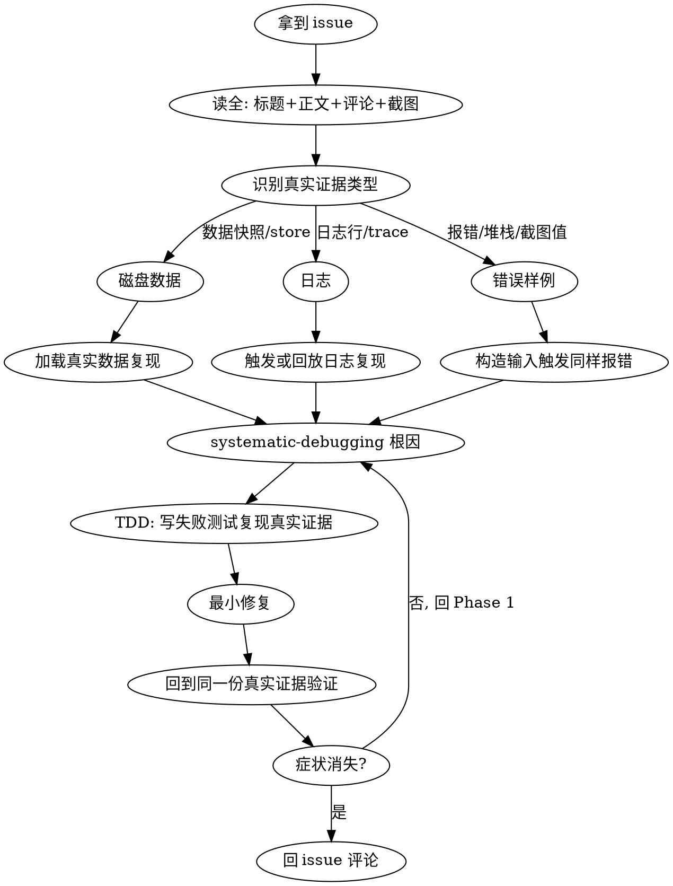

# Fix GitHub Issue

从拿到 GitHub issue 到回评论的端到端修复流程。

## Overview

核心原则:**永远对着 issue 里的真实证据(磁盘数据 / 日志 / 错误样例 / 截图中的值)复现 bug,不凭文字描述猜合成场景;修完回到同一份证据上验证症状消失**——而不只是单测通过。

**REQUIRED BACKGROUND:** 先掌握 `superpowers:systematic-debugging` 与 `superpowers:test-driven-development`。本技能编排它们,不重复其内容。

## When to Use

- 用户给出 GitHub issue 链接,或说「修一下这个 issue」/「fix issue #N」
- issue 里带可复现的真实证据:数据快照、日志行、错误样例、截图

**When NOT to use:**
- 无 issue 来源的普通 bug(直接用 `superpowers:systematic-debugging`)
- 纯需求/功能请求(没有 bug 行为可复现)
- issue 已明确是别处重复,只需关单

## 决策流程图



## Quick Reference

| 步 | 做什么 | 工具/技能 |
|---|---|---|
| 1. 取 issue | 标题+正文+评论+截图,逐字读 | REST API(公开 repo 免鉴权)/ `gh` |
| 2. 按真实证据复现 | 数据/日志/错误样例,不靠假设 | 本技能核心 |
| 3. 根因+TDD 修复 | 失败测试复现真实场景 → 最小修复 | systematic-debugging + test-driven-development |
| 4. 回同一份证据验证 | 在真实数据/日志/错误上确认症状消除 | 本技能核心 |
| 5. 回 issue 评论 | root cause + 修复 + 验证 | `gh issue comment` / REST API |

## Implementation

### 1. 取 issue
公开 repo 用 REST API 免鉴权读(正文含 markdown + 截图 URL):
```bash
curl -s "https://api.github.com/repos/<owner>/<repo>/issues/<n>"
curl -s "https://api.github.com/repos/<owner>/<repo>/issues/<n>/comments"
```
`gh` 可用则 `gh issue view <n> -R <owner>/<repo> --comments`。截图走 WebFetch 被拦时,从 issue body 抽 URL 单独处理。

### 2. 按真实证据复现
从 issue 里挑出**具体证据**(一个值、一行日志、一个报错),对着它复现,而不是照文字描述编测试。例:issue 说 metadata `message_count:3` 但实际 2 条 → 去磁盘找那个 session,读 `metadata.json` + `history.json`,确认 3 vs 2 的真实来源。没有本地数据时,用 issue 里的日志行或报错样例触发同样输出。

### 3. 根因 + TDD 修复
按 systematic-debugging Phase 1 收证据找根因,再用 test-driven-development:**先写一个失败测试,用真实证据的场景**(如 append system+user+assistant 后断言 count==2 而非 3),看它 RED,再写最小修复看 GREEN。

### 4. 回到同一份真实证据验证
不止跑单测。回到第 2 步那份真实数据/日志/错误上,确认症状消除。例:对真实 session 跑 `list_sessions`,看 count 从 3 变 2;再跑全量测试确认无回归。

### 5. 回 issue 评论
发 root cause + 修复点(文件/函数)+ 验证。`gh` 可用:
```bash
gh issue comment <n> -R <owner>/<repo> --body-file comment.md
```
`gh` 不可用时,用 git 凭证管理器里存的凭证调 REST API(**token 不打印、不写日志**):
```python
import subprocess, json, urllib.request
c = subprocess.run(["git", "credential", "fill"],
    input="protocol=https\nhost=github.com\n\n",
    capture_output=True, text=True, timeout=20)
tok = next((l[9:] for l in c.stdout.splitlines() if l.startswith("password=")), None)
assert tok, "no github credential stored"
body = json.dumps({"body": open("comment.md", encoding="utf-8").read()}).encode()
req = urllib.request.Request(
    "https://api.github.com/repos/<owner>/<repo>/issues/<n>/comments",
    data=body, method="POST",
    headers={"Authorization": "Bearer " + tok, "Accept": "application/vnd.github+json",
             "Content-Type": "application/json", "User-Agent": "fix-github-issue"})
print(urllib.request.urlopen(req, timeout=30).status)
```

## Common Mistakes

| 错误 | 后果 | 正确做法 |
|---|---|---|
| 照 issue 文字描述编合成复现 | 修的不是真 bug | 找 issue 里的真实证据(数据/日志/错误)对着复现 |
| 只跑单测就收工 | 真实症状还在 | 回到第 2 步那份真实证据上再验证一次 |
| 把「真实数据」写死成磁盘文件 | 日志/错误类 issue 用不上 | 证据可是数据/日志/错误样例/截图值,按类型分支 |
| 用 `git credential fill` 时打印 token | 凭证泄露 | 只取 password 行进变量,不 echo,不写日志 |
| issue 只读标题不读正文+评论 | 漏掉截图/复现信息 | 取 issue 时把 body + comments 全读 |
| 跳过根因直接改症状 | 修完还复发 | systematic-debugging Phase 1 先走完 |
| 改完不回评论 | 用户不知道修了 | 第 5 步:回 issue 发 root cause + 修复 + 验证 |

## Real-World Impact

issue #5「session 中会话数量不对」:`metadata` 显示 `message_count:3`,实际可见会话 2 条。从磁盘真实 session 复现——`history.json` 是 system+user+assistant 三条,而前端 `fromHistory` 过滤了 system。根因是 `SessionStore._update_metadata` 把注入的系统提示词也算进了计数。TDD 写失败测试(`assert 3==2`)→ 修复(写路径不数 system + 读路径重算)→ 回到同一份真实 session 验证 count 由 3 变 2,全量 509 passed 无回归,再回 issue 评论。全流程一轮定位。
