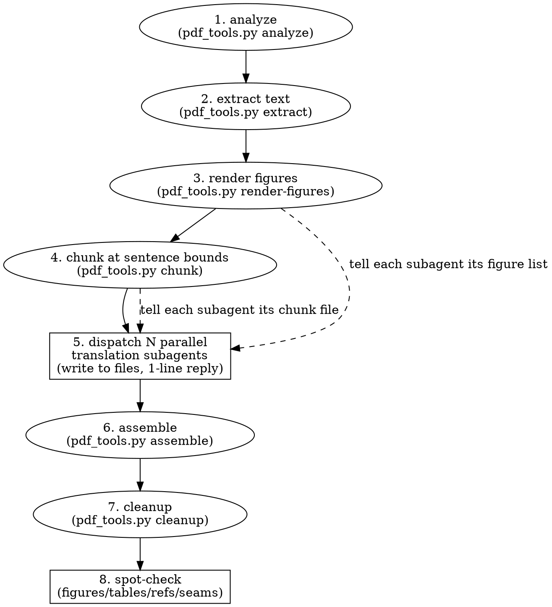

# Translate PDF Paper

Translate a long PDF (academic paper, survey, report) into another language as one Markdown file — preserving all figures and reconstructing tables — without blowing the context window.

## Overview

Core principle: **decompose, never translate inline.** A 77-page paper is ~320k chars; translating it in one agent collapses quality mid-document and exhausts context. Instead: the main agent runs a script to extract text + render figure crops + split the text into char-balanced chunks at **sentence boundaries**; then dispatches **parallel translation subagents**, each writing its chunk to a file and returning only a one-line confirmation; then assembles + cleans up. Figures are rendered as cropped PNGs (not extracted as embedded images — those are often fragments, and vector figures have no raster); tables are reconstructed as Markdown (PDF extraction scrambles columns into a vertical cell sequence, but all data is present).

## Prerequisites

- **Python 3** + **PyMuPDF** (`pip install PyMuPDF`). Import as `pymupdf` (the `fitz` alias is deprecated).
- The translation subagents use the same model family as the main agent — dispatch them as **forks** (inherit context, same model) or **general-purpose** agents (fresh, self-contained prompt). Prefer general-purpose with a self-contained prompt (see references) to avoid N× context inheritance cost; use forks only when model consistency is critical.

## When to Use

- User says “translate this PDF to Chinese / 把这篇论文翻译成中文”, “translate the paper and keep the images”, “translate and keep figures”.
- The source is a multi-page PDF (≥ ~15 pages / ~60k chars) — long enough that inline translation is the wrong tool.
- Output as Markdown is acceptable (Markdown renders inline images via ``; PDF generation with embedded CJK fonts is far harder — prefer Markdown unless the user insists on PDF).

**When NOT to use:**
- A few pages / a short article → translate inline directly; no need to decompose.
- Source is already Markdown/HTML → just translate the text, no PDF extraction.
- User wants a verbatim layout clone (pixel-perfect) → this skill reflows text and reconstructs tables, it does not reproduce page layout.

## Workflow



## Quick Reference

| Step | Command | What it does |
|---|---|---|
| 1. Analyze | `python ${CLAUDE_PLUGIN_ROOT}/scripts/pdf_tools.py analyze <pdf>` | Prints page count, total chars, every `Figure N`/`Table N` caption with its page; writes `figures.json` + `tables.json`; suggests chunk count (~40k chars/chunk). |
| 2. Extract text | `python ${CLAUDE_PLUGIN_ROOT}/scripts/pdf_tools.py extract <pdf> all_text.txt` | Per-page text with `===== PAGE N =====` markers. |
| 3. Render figures | `python ${CLAUDE_PLUGIN_ROOT}/scripts/pdf_tools.py render-figures <pdf> images` | Renders each figure REGION to `images/figureN.png` (3× zoom). Raster figure = union of image rects; vector figure = full-width top-of-page to caption. |
| 4. Chunk | `python ${CLAUDE_PLUGIN_ROOT}/scripts/pdf_tools.py chunk all_text.txt <N> _chunks` | Splits flowing text (markers stripped) into N chunks **at terminal punctuation** so no sentence spans chunks. Prints each chunk’s char count and which figures’ captions land in it. |
| 5. Translate | dispatch N parallel subagents | Each reads `chunkN.txt`, writes `out_chunkN.md`, returns 1 line. Prompt = `references/translation-guidelines.md` customized with the chunk’s figure list. |
| 6. Assemble | `python ${CLAUDE_PLUGIN_ROOT}/scripts/pdf_tools.py assemble header.md out.md _chunks/out_chunk*.md` | Concatenates header + chunks in order. |
| 7. Cleanup | `python ${CLAUDE_PLUGIN_ROOT}/scripts/pdf_tools.py cleanup out.md` | Keeps ONE `参考文献/References` heading, strips `N.` numeric prefixes, drops `……` continuation markers + chunk markers, collapses 3+ blank lines. |
| 8. Verify | spot-check | Confirm: figure refs = figure count, table captions = table count, single reference heading, abstract complete, no `……` seams. |

## Implementation

Run the script from the output directory so `figures.json`/`images/` land beside the final `.md`:

```bash
cd <where the translated .md should live>
python ${CLAUDE_PLUGIN_ROOT}/scripts/pdf_tools.py analyze "<path/to/paper.pdf>"
python ${CLAUDE_PLUGIN_ROOT}/scripts/pdf_tools.py extract  "<path/to/paper.pdf>" all_text.txt
python ${CLAUDE_PLUGIN_ROOT}/scripts/pdf_tools.py render-figures "<path/to/paper.pdf>" images
python ${CLAUDE_PLUGIN_ROOT}/scripts/pdf_tools.py chunk all_text.txt <N> _chunks
```

Then write a small `header.md` (translated title + `> 原文标题：…` + `> 译者说明：…` + `---`), dispatch the N subagents using the prompt in `references/translation-guidelines.md`, and finish:

```bash
python ${CLAUDE_PLUGIN_ROOT}/scripts/pdf_tools.py assemble header.md "<译名>.md" _chunks/out_chunk*.md
python ${CLAUDE_PLUGIN_ROOT}/scripts/pdf_tools.py cleanup "<译名>.md"
```

**Dispatch rule:** send all N subagents in ONE message (multiple Agent tool calls) so they run concurrently. Each writes its own file → no shared state, no conflicts. They return only a confirmation → the heavy translated text never enters the main context.

## Common Mistakes

| Mistake | What happens | Fix |
|---|---|---|
| Translate inline (one agent) | ~320k chars blow the context window; quality degrades then stops mid-document. | Decompose: script extracts + chunks; parallel subagents write files. |
| Split chunks on page boundaries | Sentences that span page breaks get duplicated or fragmented at chunk seams. | Chunk at **sentence boundaries** (terminal punctuation) — `chunk` subcommand does this. |
| Extract embedded images for figures | “Images” are often tile fragments; vector figures have no raster at all. | Render the figure REGION (`render-figures`): union of image rects, or top-of-page-to-caption for vector. |
| Render tables as images | An un-translatable picture; cell text lost. | Reconstruct as Markdown from the vertical cell sequence — a capable agent regroups rows. Fallback only if truly unreconstructable. |
| Translate the reference list | Author names/titles become meaningless; citations break. | Keep bibliography in original language, unnumbered, under one heading. `cleanup` enforces this. |
| Leave PDF artifacts | `self-\nevolving` stays hyphen-broken; `Published in…` on every page. | Tell subagents to rejoin hyphens + strip running headers/page numbers (in guidelines). |
| Subagent returns the translation in its reply | The full text re-enters the main context → defeats the whole point. | Subagent writes to file, returns ONLY a one-line confirmation. |
| Numbering references inconsistently across chunks | Some chunks number `1. 2.`, others don’t → broken list. | `cleanup` strips `N.` prefixes after the first reference heading. |
| Forgetting to verify | A figure silently failed to render, or a table got dropped. | Spot-check: figure-ref count = figure count; table-caption count = table count; single reference heading; abstract complete. |

## Real-World Impact

Validated on a 77-page TMLR survey (“A Survey of Self-Evolving Agents…”, 324k chars, 9 figures, 12 tables, 102 embedded image resources). Parallel 8-subagent translation completed in ~22 min wall-clock; output 175k chars / 1713 lines; all 9 figures preserved as cropped PNGs, all 12 tables reconstructed as Markdown (verified Table 2’s 24-row •/◦ matrix and Table 7’s 25-benchmark catalog), references kept alphabetical/unnumbered English A→Z, abstract complete, cross-chunk seams stitched. No translated text entered the main agent’s context — only 8 one-line confirmations.
